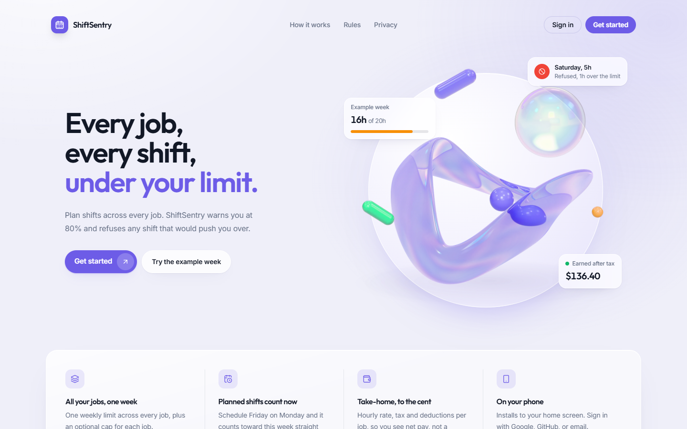
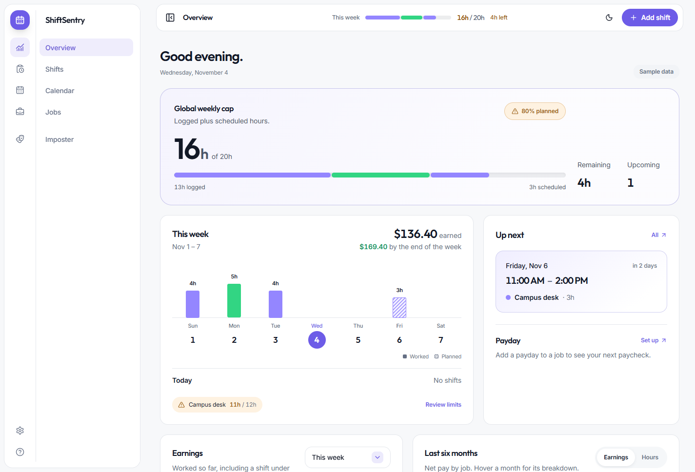
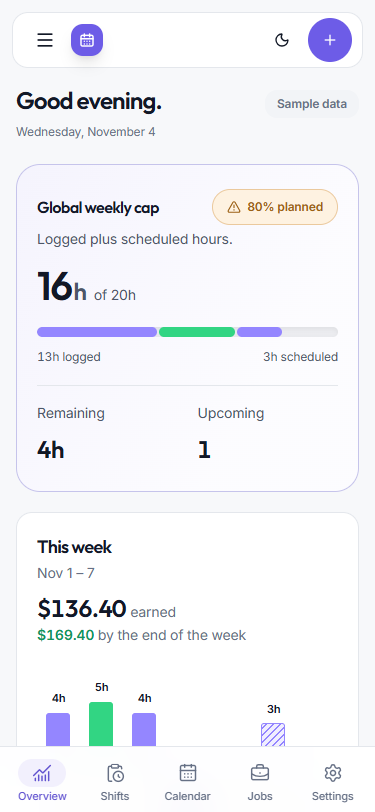
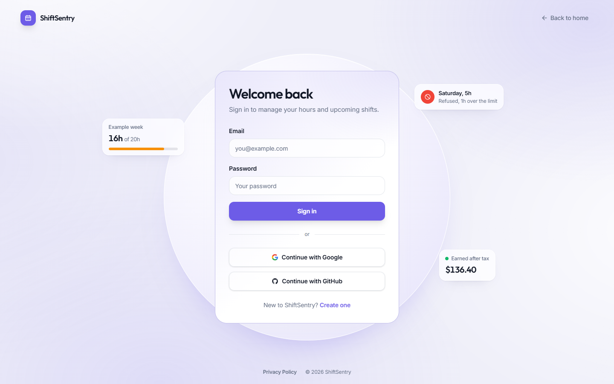
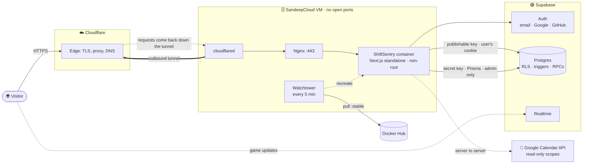
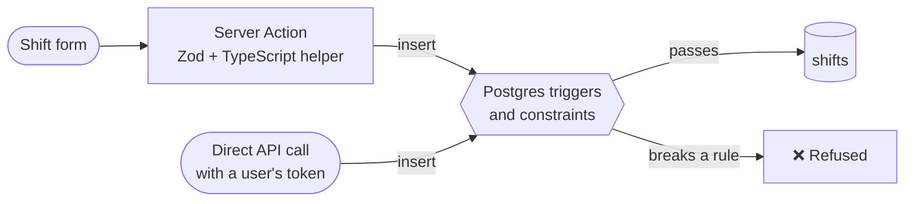
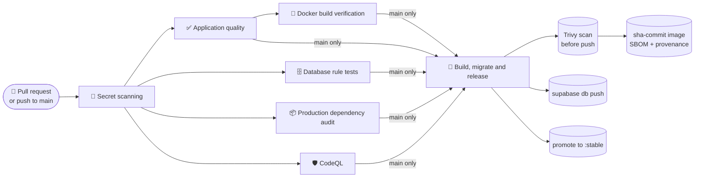

<div align="center">

# 🛡️ ShiftSentry

**A shift planner for people working more than one job. It tracks every shift, forecasts the week's hours and pay, and warns you before you cross a weekly limit. The limits are enforced in the app and again in Postgres, so a write that skips the app is still refused.**

<h3><a href="https://sentry.sandeeppokharel.com.np">View Live Site »</a></h3>

[](https://github.com/pokharelsandeep333-commits/ShiftSentry/actions/workflows/ci.yml)


</div>

---

## ✨ At a glance

| | |
|---|---|
| 🎯 **Problem** | Students and part-time workers juggle several jobs under a weekly hour limit. Going over is easy to miss until it has already happened, and net pay takes arithmetic nobody wants to do |
| 🧮 **What it does** | Shows logged plus scheduled hours against every cap, warns at 80%, 90% and 100%, and forecasts this week's pay before the week is over |
| 🔁 **Rules enforced twice** | Weekly caps, the pay snapshot, the tax-and-deductions ceiling and the no-overlap rule live in a TypeScript helper **and** a Postgres trigger or constraint. A direct authenticated write through the API hits the same wall |
| 🕰️ **Your time, your week** | Hours count in the user's time zone and chosen week start. An overnight shift is split at local midnight, and every total (week, month, all time) is built the same way, so one shift is never worth two amounts |
| 💵 **Money without floats** | Cents and basis points as integers end to end. Input is parsed with dedicated helpers, never `parseFloat` |
| 🧪 **Tested at both layers** | 37 TypeScript test files, plus 28 SQL suites that apply all 37 migrations to a throwaway Postgres and attack the triggers, policies and grants directly |
| 🚀 **Merge is deploy** | Six required checks gate `main`. A merge builds an immutable image, applies migrations, promotes it to `stable`, and the server pulls it within five minutes |

## 📸 Screens

<div align="center">



<sub><b>Landing page.</b> Public, with an interactive example week.</sub>

<br /><br />



<sub><b>Overview.</b> The weekly cap at its 80% warning, and this week's pay: solid for what is earned, dashed for what the planned shifts will add.</sub>

<br /><br />


&nbsp;&nbsp;&nbsp;


<sub><b>Phone layout</b> and <b>sign-in</b> (email, Google or GitHub).</sub>

</div>

> [!NOTE]
> Dashboard images come from the app's built-in preview mode, which renders sample data when no Supabase credentials are set. No real user data appears anywhere in this repository.

## 🧰 Features

| | Feature | What it does |
|---|---|---|
| 💼 | **Multiple jobs** | Each job has its own color, pay rate, tax and deductions, weekly cap and payday schedule. Archiving a job hides it while its shifts stay in the history |
| ⚠️ | **Weekly limits** | A global cap and per-job caps. The shift form checks a new shift (and its weekly repeats) against them before you save |
| 💰 | **Earnings** | Gross, tax, deductions and net for this week, this month, the last 3 or 6 months, year to date, all time or a custom span. Pay periods show what lands on each payday |
| 🧾 | **Honest history** | A shift remembers the rate it was worked at, so a later raise never reprices past work |
| 🗓️ | **Calendar** | Week and month views. Overnight shifts appear on both days and clashes are marked |
| 🔗 | **Google Calendar** *(optional)* | Read-only. Shows your events beside your shifts, warns when a new shift clashes, and can turn matching events into shifts for jobs that opt in. Nothing is ever written to Google |
| 📝 | **Shift log** | Paged by week, filterable by job and by worked or upcoming, with a note per week |
| 🔒 | **Account rights** | Versioned Terms with a 16+ confirmation, a JSON export of everything stored, and confirmed permanent deletion from `/account` |
| 🛠️ | **Admin area** | Users, audit log, health, integrations, announcements and game moderation. It never shows job names, shift times or note contents |
| 📱 | **Installable** | Responsive layout, light and dark themes, keyboard-accessible controls, and an installable app with an offline page |
| 🎭 | **Imposter** | A small party word game for friends, with QR-code and link invites, built on Supabase Realtime |

## 🗺️ Architecture



- **The server has no inbound ports.** `cloudflared` dials out to Cloudflare and visitors' requests come back down that connection to Nginx. The host itself is built from code in [SandeepCloud-IaC](https://github.com/pokharelsandeep333-commits/SandeepCloud-IAC).
- **Three database paths, kept apart on purpose:**

| Path | Key | Used for |
|---|---|---|
| `createServerSupabaseClient()` | publishable, bound to the user's cookie | **Every user-facing read and write.** Row Level Security scopes each row to its owner |
| `createAdminSupabaseClient()` | `SUPABASE_SECRET_KEY` | Admin only: role changes, ban and unban, password-reset mail |
| `prisma` | `DATABASE_URL` | Admin only: audit events and user lookups |

The last two bypass RLS, so they are server-only and never imported into a client component. When an RLS query is awkward, the policy gets fixed instead.

### 🔁 One rule, two layers



| Rule | In the app | In Postgres |
|---|---|---|
| Weekly hour caps (global and per job) | `src/lib/limit-check.ts`, `src/app/actions/work.ts` | `enforce_shift_weekly_limits` trigger |
| Pay rate frozen onto the shift | `src/lib/earnings.ts` | `shifts_sync_earnings_snapshot` trigger |
| Tax plus deductions can't exceed 100% | `checkCombinedRate` in `work.ts` | `enforce_job_compensation_rate` trigger on jobs and deductions |
| No overlapping shifts | `src/lib/limit-check.ts` | `shifts_no_overlap` exclusion constraint |
| Latest Terms accepted before any write | server guards | `require_current_legal_agreement` trigger |
| A disabled account stops writing at once | `src/lib/auth.ts` redirect | restrictive `is_account_enabled()` policies |

The user-local week start is written out in three places that must match: the trigger, `shift_week_count_before`, and `weekStartFor()` in `src/lib/time.ts`. The SQL suites pin all of them.

## 🔄 CI/CD pipeline



| Job | What it runs | Required on `main` |
|---|---|---|
| 🔐 **Secret scanning** | gitleaks across the whole git history | ✅ |
| ✅ **Application quality** | Prisma generate and validate, every unit suite, the legal snapshot check, `tsc`, ESLint, a production build | ✅ |
| 🗄️ **Database rule tests** | All migrations onto a fresh Postgres, then the 28 SQL suites | ✅ |
| 📦 **Production dependency audit** | `npm audit` on runtime dependencies. Any high or critical advisory fails, with no allowlist. A malformed report fails too | ✅ |
| 🐳 **Docker build verification** | The production Dockerfile with placeholder values, plus the pinned Supabase CLI the release uses | ✅ |
| 🛡️ **CodeQL** | JavaScript and TypeScript analysis into GitHub code scanning | ✅ |
| 📋 **Dependency review** | New dependencies in a pull request, failing on high severity | PRs only |
| 🚀 **Build, migrate and release** | Build the image locally, scan it with Trivy (fixable critical/high, SARIF into code scanning; report-only for now), then push `sha-<commit>`, dry-run then apply migrations, promote the same image to `stable` | Runs after merge |

**How the pipeline is locked down**

- 📌 Every third-party action is pinned to a **full commit SHA**.
- 🔑 Every workflow starts at `contents: read`. Only the CodeQL jobs and the jobs that upload Trivy results get `security-events: write`.
- 🔍 Trivy runs from its image pinned by digest, reading a `docker save` tarball with no Docker socket mounted. The Trivy GitHub Actions are not used.
- 🧱 Migrations run **before** `stable` moves, so a new schema never waits on an old image for long.
- 🩺 `/api/health` returns `{ status, commit }`, with the commit baked into the image. A release counts as live only when that commit matches the merge.
- 🗓️ Scheduled jobs: CodeQL weekly, the dependency audit weekly, a weekly Trivy scan of the `stable` image production runs, and a daily purge of security audit rows older than 30 days. Dependabot proposes npm, Docker and Actions updates weekly.

## 🛡️ Security controls in the code

| Control | Where |
|---|---|
| 🧾 Nonce-based CSP with `'strict-dynamic'`, **no `'unsafe-inline'` for scripts**, no external script, style, image or font hosts | `src/lib/content-security-policy.ts`, `src/proxy.ts` |
| 🔗 `connect-src` names this project's own Supabase origin, not `*.supabase.co`, so a stolen token can't be posted to another project | same |
| 🔐 Google tokens encrypted with AES-256-GCM. Event titles are never stored | `src/lib/google/token-crypto.ts` |
| 🚦 Per-user rate limits on account export and deletion, terms acceptance, the Google routes and the limit check | `src/lib/rate-limit.ts` |
| ✅ Every Server Action input validated with Zod on the server | `src/lib/validation.ts`, `src/app/actions/` |
| 🎲 Every game write goes through a security-definer RPC. The game's Server Actions never call `.insert()` or `.update()` | `src/app/actions/game.ts`, `supabase/migrations/` |
| 🗑️ Deletion locks the account first, revokes sessions, then deletes. A failed step never unlocks automatically | `src/app/actions/account.ts` |
| 📜 Published legal texts are immutable: a snapshot in a migration, checked in CI | `scripts/snapshot-legal.mjs` |
| 🐳 Image runs as a non-root user with a health check | `Dockerfile` |

## 📁 Repository layout

```text
.
├── 🧭 src/app/                  App Router pages, Server Actions, auth and OAuth callbacks, /api/health
├── 🧩 src/components/           Dashboard, calendar, shifts, game, admin, and the UI primitives
├── 🧮 src/lib/                  Money, time, limits, period totals, Supabase clients, Google, CSP (+ unit tests)
├── 🗄️ supabase/migrations/      37 immutable, timestamped migrations: schema, RLS, triggers, RPCs
├── 🧪 supabase/tests/           28 SQL suites and the harness they run in
├── 🔷 prisma/                   Typed mirror of the schema for the admin client (the SQL is the source of truth)
├── 🛠️ scripts/                  SQL test runner, audit gate, retention purge, legal snapshot, license notices, landing-art renderer
├── 🎨 public/                   Service worker and the pre-rendered landing art
├── 📖 docs/                     Screenshots, privacy operations, and third-party license texts
└── ⚙️ .github/                  CI/CD, CodeQL, dependency audit, image scan, data retention, Dependabot
```

## 🚀 Running it locally

**You need** Node.js 24, a Supabase project, and Docker (only for the SQL tests or the production image).

```bash
git clone https://github.com/pokharelsandeep333-commits/ShiftSentry.git
cd ShiftSentry
npm install
cp .env.example .env.local      # PowerShell: Copy-Item .env.example .env.local
npm run dev                     # http://localhost:3000
```

> [!TIP]
> With no Supabase values in `.env.local`, the app boots into a read-only preview with sample data. That is enough to click around.

**With a real Supabase project**

1. Fill in `.env.local`. Only the two `NEXT_PUBLIC_SUPABASE_*` values reach the browser; `SUPABASE_SECRET_KEY`, `DATABASE_URL` and `ADMIN_EMAIL_ALLOWLIST` stay on the server.
2. Apply the schema:
   ```bash
   npx supabase login
   npx supabase link --project-ref <your-project-ref>
   npx supabase db push
   ```
3. In Supabase Auth, set the Site URL to `http://localhost:3000`, allow the redirect `http://localhost:3000/auth/callback`, and enable Email, Google and GitHub.
4. *Optional, Google Calendar:* create a separate Google OAuth client with the redirect `http://localhost:3000/integrations/google/callback`, fill in the `GOOGLE_*` values (`.env.example` has the command for the encryption key), and set `GOOGLE_CALENDAR_ENABLED=true`.

**Run what CI runs**

```bash
npm run db:generate
npm run test:earnings && npm run test:auth && npm run test:game && npm run test:security
npm run test:sql               # needs Docker; cleans up its container afterwards
npm run check:legal
npx tsc --noEmit
npm run lint
npm run audit:production
npm run build
```

## 🚢 Shipping

`main` is protected by the six required checks above, with force-push and deletion turned off. The `production` environment has no approval gate, so **merging a green pull request deploys it**:

1. The release job builds the image, scans it with Trivy, then pushes `sha-<commit>` with an SBOM and provenance.
2. `supabase db push --dry-run`, then `supabase db push`.
3. The same image is promoted to `stable`.
4. Watchtower on the server pulls it within about five minutes.
5. An operator polls [`/api/health`](https://sentry.sandeeppokharel.com.np/api/health) until `commit` matches the merge. GitHub-hosted runners get HTTP 403 from the public edge, so a green release job proves promotion, not what is serving.

Migrations are never edited after they are applied. A schema change is always a new timestamped file.

---

<div align="center">
<sub>Built by <a href="https://github.com/pokharelsandeep333-commits">Sandeep Pokharel</a> · Next.js · Supabase · Postgres · Docker · GitHub Actions · Cloudflare</sub>
</div>
